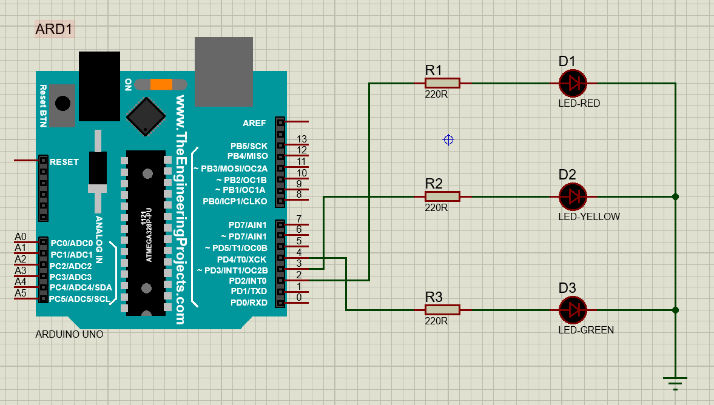

# Arduino Traffic Light (Proteus)

This is a simple traffic light project. I made it in Proteus using an Arduino UNO.

# What I used
* Arduino UNO
* 3 LEDs (red, yellow, green)
* 3 resistors, 220 ohm each

# Connections
* Red LED is connected to pin 2
* Yellow LED is connected to pin 3
* Green LED is connected to pin 4

## How it works
Green stays on for 5 seconds, then yellow for 2 seconds, then red for 5 seconds. After that it starts again from green.

#Circuit

# How to run
Open the .pdsprj file in Proteus. Double click the Arduino and select the .hex file as the program file. Then press play.

# Made by
Abdullah Al Mahfuj Mahi
